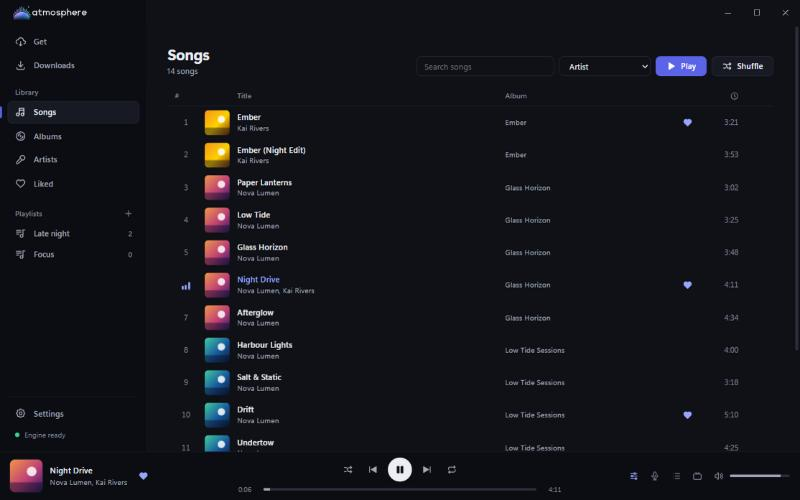
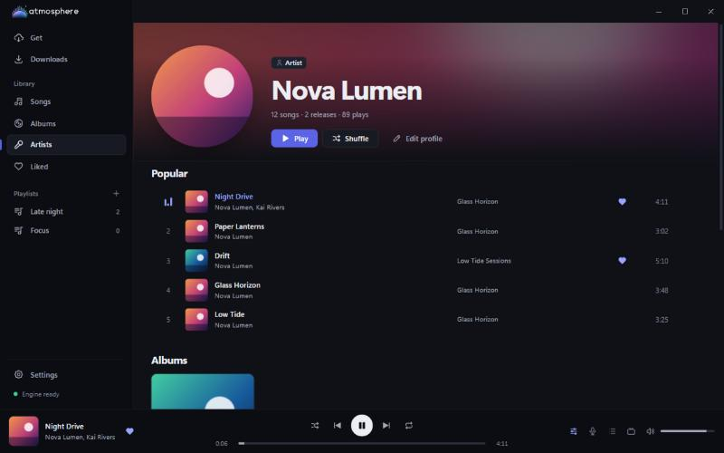
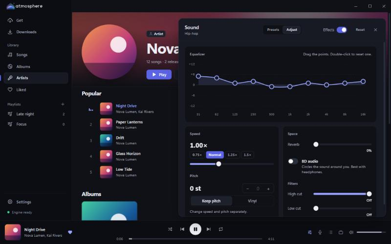
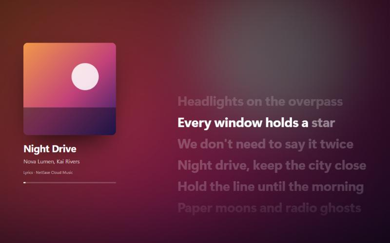
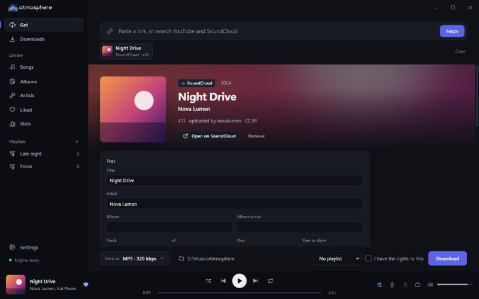
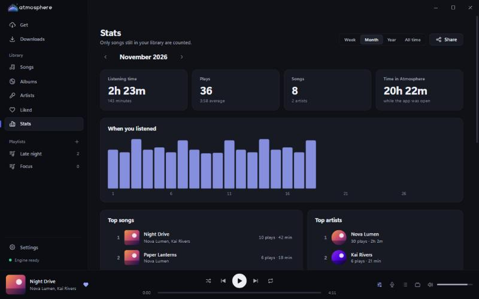
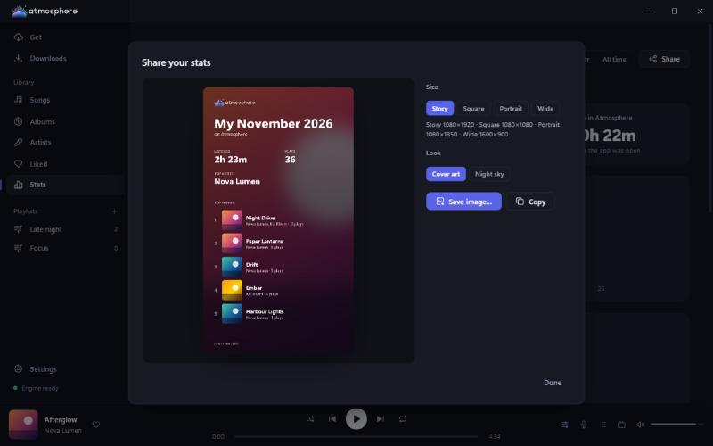

<p align="center">
  <picture>
    <source media="(prefers-color-scheme: dark)" srcset="branding/logo-lockup-light.svg">
    <source media="(prefers-color-scheme: light)" srcset="branding/logo-lockup-dark.svg">
    
  </picture>
</p>

<p align="center">
  <b>Your music, beautifully kept.</b><br>
  A fast, native music library, player and downloader for Windows, macOS and Linux.
</p>

<p align="center">
  
  
  
  
</p>

<p align="center">
  
</p>

---

Atmosphere puts your library, a good-sounding player and a downloader in one app. Paste a link from SoundCloud, YouTube, Bandcamp or [1,000+ other sites](https://github.com/yt-dlp/yt-dlp/blob/master/supportedsites.md). Atmosphere shows you exactly what's available and saves a properly tagged file. The file lands in your library, attached to its artist and album, ready to play with synced lyrics.

It's built for media you **own or have the rights to keep**, such as your own uploads, artist-enabled downloads and Creative Commons releases, and it never bypasses DRM.

## A look around

<table>
  <tr>
    <td width="50%"><br><sub><b>Artist profiles</b>: popular tracks, releases, appears-on, and your own photo and bio.</sub></td>
    <td width="50%"><br><sub><b>Sound</b>: a drag-to-shape EQ, presets, independent pitch and tempo, reverb and 8D.</sub></td>
  </tr>
  <tr>
    <td><br><sub><b>TV mode</b>: full-screen cover art and word-synced lyrics, on any connected screen.</sub></td>
    <td><br><sub><b>Get</b>: honest format choices, editable tags, lyrics detected from the description.</sub></td>
  </tr>
  <tr>
    <td><br><sub><b>Stats</b>: listening time, plays, and top songs, artists and albums by week, month or year.</sub></td>
    <td><br><sub><b>Share cards</b>: branded images sized for Stories, posts, X and Discord.</sub></td>
  </tr>
</table>

<sub>Screenshots use demo data with generated cover art.</sub>

## Features

### Library
- **Home** greets you with what you played recently, what's new, what's on repeat and your playlists.
- **Search everything** with `Ctrl K`: songs, albums, artists and playlists, ranked by what you play most. Paste a link there to get it.
- **Your folders:** the download folder plus any music folders you add. Scans are incremental, and a **live file watcher** picks up added, moved or deleted files within about a second.
- **Songs, Albums, Artists, Liked.** The song list is virtualized, so big libraries scroll smoothly. Search and sort everywhere.
- **Artist profiles** with popular tracks, albums, singles & EPs, and **Featured on**, which shows the release type and which song features them. Photos, bios and logos are found automatically from Deezer, Wikipedia, Wikidata and TheAudioDB (keyless, can be turned off). Not the right artist? Search online and pick a photo, logo or bio, or use your own images.
- **Edit everything:**
  - songs, several songs at once, and whole albums, including one cover for every track
  - playlists: name and cover, saved as `cover.jpg` so other players show it too

  Edits are written into the files' tags.
- **Playlists are real folders** on your drive, so phones, USB drives and other players can use them as-is. Songs are hard-linked (no extra space) or copied, and a `playlist.m3u8` keeps the order.
- **Use folders you already have** as playlists. Atmosphere never moves or deletes them. If one goes missing (renamed, moved, or on an unplugged drive), it's marked as missing with **Locate folder**, and it comes back by itself when the drive reconnects.
- **Open with Atmosphere:** double-click an audio file to play it, or drop files on the window to add them to your library.
- **Move your music** to a new folder and Atmosphere offers to bring everything along, including play counts, likes and playlists.
- **Multi-select** with Ctrl/Shift-click. Drag songs onto playlists, play next, add to queue, edit tags, **remove from library** (the file stays) or **delete from device** (sent to the Recycle Bin or Trash).

### Player
- **Gapless playback:** the next song is always loaded ahead and blended in as the current one ends, so albums and mixes flow without a gap, and skipping is instant.
- **Crossfade** (optional, up to 12 s). Songs from the same album always stay gapless.
- **Even out volume** (optional): plays quiet and loud songs at a similar level, using ReplayGain tags or a one-time measurement. Files are never changed.
- Queue, shuffle and repeat. Save the queue as a playlist. Resumes where you left off, and songs over 20 minutes pick up mid-song. Works with OS media keys, and counts plays.
- **Sleep timer** that fades out, or stops at the end of the song.
- **Song info:** format, bitrate, sample rate, size, plays, dates and location.
- **Music videos:** save a video and its audio together, then switch to the video (`V`) at the same moment without interrupting the song.
- **Sound panel:**
  - Presets: Bass boost, Vocal, Rock, Hip-hop, Nightcore, Slowed + reverb, Vaporwave, Lo-fi, 8D, Concert hall, and your own.
  - A 10-band EQ you shape by dragging.
  - Low-cut and high-cut filters, reverb and 8D panning.
  - **Pitch** (±12 semitones) and **tempo** (0.5×–2×), changed independently, or linked in **Vinyl** mode.
  - An Effects on/off switch for instant comparison.
- **TV mode** (`F`): full-screen with the cover-art backdrop and big synced lyrics, or a visualizer when there are none. Sends to a second screen when one is connected.
- **Mini player** (`P`): resize it into a card, a wide strip (art left, controls right) or a tiny bar. It has optional cover art, a blurred-cover backdrop, a lyrics preview or a reorderable queue, and always-on-top.

### Lyrics
- Synced line by line, plus **word by word** when the source supports it. Click a line to jump, nudge the timing, and save `.lrc` files.
- **Soft focus:** lines blur gently the further they are from the one being sung, and hovering any line brings it into focus. You can turn this off in Settings.
- **Free sources:** no key needed and on by default.

  | Source | Key | Notes |
  | --- | --- | --- |
  | Your files | No | Embedded lyrics tags and `.lrc` sidecar files |
  | [LRCLIB](https://lrclib.net) | No | Free, community-synced library |
  | NetEase Cloud Music | No | Free; often word-synced, with translations |
  | Musixmatch | Your key | Official developer API (free tier available) |
  | Kugou | No | Often blocked outside China, so it's off by default |
  | Custom | Yours | Any service you have access to: URL template, headers, key and format |

- **Attach your own lyrics** while downloading or later. Paste or import a `.lrc`/`.txt` file, then sync it yourself with **Stamp current time** while the song plays.
- **Lyrics in descriptions:** lyrics an artist put in a SoundCloud description are detected, split from the credits and links, and prefilled.

### Downloads
- One bar for links and search (YouTube and SoundCloud). Paste anywhere, drag links in, or accept the "Use copied link" offer.
- **Direct file links** ending in `.mp3`, `.wav`, `.flac`, `.mp4` and similar are checked first to make sure they're real media, then read for their actual bitrate, length, tags and cover art.
- **Organized folders:** albums go in `Albums`, playlists in `Playlists` (where they show up as playlists) and single songs in `Tracks`. A single song from an album you already have joins that album's folder, and when you give a song in `Tracks` an album, it moves into that album's folder along with its lyrics and video. Plays and likes come along too.
- **Clean titles:** YouTube's "(Official Music Video)" and similar tags are removed, and "Artist - Title" uploads get the real artist. When you save only the sound of a music video, Atmosphere prefers the artist's official audio upload.
- **Release detection:** Album, EP, Single, LP, Compilation, Mixtape, Playlist, Profile and Channel. This drives track numbering, album tags and folder names.
- **Save as** describes outcomes:
  - Original file
  - Best quality
  - MP3
  - M4A
  - FLAC/WAV
  - Video at the resolutions that item actually has

  **Bitrates never exceed the source.** Matching codecs are copied rather than re-encoded.
- Metadata editing per release and per track: composer, ISRC, BPM, key, cover art and trimming.
- Downloads run in **track order**, with progress, retry, history, and skipping of anything downloaded before.
- Extras: chapters, subtitles, SponsorBlock, a speed limit, a proxy, and sign-in for your own private uploads, either from your browser or from a `cookies.txt` file. **Check** confirms it works and explains what to do if it doesn't. For example, Chromium browsers lock their sign-in while they're open.

### Connections
- **Discord:** show what you're listening to, with the cover, artist and a progress bar. Choose whether your status names Atmosphere, the artist or the song, and whether it stays while paused. You can also use your own Discord app, so your status shows its name: **Save the images** puts the art Discord needs in a folder you choose, with the setup steps.
- An optional **local API** lets other apps on your computer, like stream overlays, status tools or your own scripts, see what's playing, browse your library, control playback and send links to Get.
- It's off until you turn it on, listens on `127.0.0.1` only, and needs a token that's shown once and stored only as a fingerprint.
- You choose what apps may do, and browser pages are refused. See the [API guide](docs/api.md).

### Stats
- Week, month, year or all time: listening time, plays, songs, artists, time in the app, a by-day chart, and top songs, artists and albums.
- Songs you delete are removed from your history.
- **Share cards** with the Atmosphere logo:
  - Story 1080×1920
  - Square 1080×1080
  - Portrait 1080×1350
  - Wide 1600×900

  Choose a cover-art or night-sky look, then save as PNG or copy to the clipboard.

### The app itself
- **About 8 MB**, native on each OS. Custom title bar and right-click menus throughout. Light and dark themes.
- **Portable:** `atmosphere.exe` runs from any folder. Put an empty file named `portable` next to it, and all data stays beside it.
- **Tidy:** temp files and stalled partial downloads are cleared automatically on launch, whenever downloads finish, and on exit. **Settings → Storage** shows what Atmosphere keeps and lets you clean it up.
- **Back up and restore** your settings, stats, liked songs and artist photos as a single `.zip` from **Settings → Storage**.
- **Automatic updates:** Atmosphere checks this repo's releases when it opens and every few hours while it's open. When there's a new version, a notice shows what's new with **Update and restart**: one click downloads it, verifies its signature, installs it and reopens Atmosphere where you left off. You can turn checking off in Settings.
- **Clean uninstall:** the Windows uninstaller keeps your data by default. If you choose to delete it, you're offered a backup first. Your music files are never touched.

## Get started

### Download
Grab the latest version from [Releases](../../releases/latest). Installed copies keep themselves up to date.

| Platform | Files |
| --- | --- |
| Windows | Setup `.exe`, `.msi`, or the portable `atmosphere.exe` |
| macOS | `.dmg` (Apple Silicon and Intel) |
| Linux | `.deb`, `.rpm`, `.AppImage` |

On first launch:
1. Confirm the three rights statements. The Windows installer covers this on its licence page.
2. Let Atmosphere set up its engine: [yt-dlp](https://github.com/yt-dlp/yt-dlp) and [ffmpeg](https://ffmpeg.org), downloaded from their official releases and checksum-verified. On macOS, install ffmpeg with `brew install ffmpeg`.
3. Add your music folders in **Settings → Library**, or paste a link.

### Build from source
You'll need [Rust](https://rustup.rs). On Linux, also install the WebKitGTK dependencies:

```bash
sudo apt install libwebkit2gtk-4.1-dev libgtk-3-dev libayatana-appindicator3-dev librsvg2-dev patchelf
```

Run the app:

```bash
cargo run --release
```

Build installers with the Tauri CLI:

```bash
cargo install tauri-cli --version "^2"
cargo tauri build
```

## Keyboard shortcuts

| Keys | Action |
| --- | --- |
| `Space` | Play / pause |
| `←` `→` | Seek 5 seconds |
| `Ctrl ←` `Ctrl →` | Previous / next track |
| `M` | Mute |
| `L` | Lyrics |
| `Q` | Queue |
| `F` | TV mode |
| `V` | Show the music video, when a song has one |
| `Ctrl K` | Search your library, or paste a link |
| `Ctrl L` | Get: the link and online search bar |
| `Ctrl B` | Collapse or expand the sidebar |
| `P` | Mini player |
| `Ctrl F` | Search the current view |
| `Delete` | Delete the selected songs (with confirmation) |
| `Ctrl A` | Select all in the current list |

On macOS, use `⌘` in place of `Ctrl`.

## Responsible use

Atmosphere is for media you own or are allowed to keep.

- **Before first use**, you agree to three statements about rights and responsibility. On Windows, that's the installer's licence page. The portable app, macOS and Linux ask once inside the app. **Each download** also asks for confirmation. The app's backend enforces both, not only the UI.
- It **never bypasses DRM or paywalls**, and skips preview-only media, the same way yt-dlp itself refuses encrypted formats.
- **Artists recovering their own uploads** can enable downloads on the track and choose **Original file** to get the uploaded master.

## Project layout

| Path | What's there |
| --- | --- |
| `src/main.rs` | Tauri setup, the rights gate, and app commands |
| `src/engine.rs` | Installs and runs yt-dlp and ffmpeg (SHA-256 verified), portable mode |
| `src/media.rs` | Link probing, playlist streaming, release detection, lyrics found in descriptions |
| `src/downloader.rs` | The ordered download queue, format plans and progress |
| `src/library.rs`, `src/libcmd.rs` | Library, artwork, folder playlists, stats, the file watcher, and the `atmo://` media protocol |
| `src/lyrics.rs` | Lyrics providers, LRC and word-timing parsing, cache |
| `src/storage.rs` | Temp-file cleanup and the Storage report |
| `src/direct.rs` | Checks and reads direct audio and video file links |
| `src/backup.rs` | Backup and restore of settings, stats and liked songs |
| `src/api.rs` | The opt-in local API for other apps ([guide](docs/api.md)) |
| `src/updates.rs` | Signed in-app updates from GitHub Releases ([releasing](docs/releasing.md)) |
| `src/artistinfo.rs` | Artist photos, bios and logos from Deezer, Wikipedia, Wikidata and TheAudioDB |
| `src/discord.rs` | Discord Rich Presence over Discord's local connection, and its art assets |
| `src/tagging.rs` | Writes tags, cover art and lyrics into files |
| `ui/` | The interface in plain HTML, CSS and JS (no build step) |
| `branding/`, `tools/` | The logo, wordmark lockups and installer art, all generated from code |
| `site/` | The upcoming website |

## Acknowledgements

Atmosphere is built on:
- **Engine and app:** [yt-dlp](https://github.com/yt-dlp/yt-dlp), [FFmpeg](https://ffmpeg.org), [Tauri](https://tauri.app) and [lofty](https://github.com/Serial-ATA/lofty-rs).
- **Icons:** [Tabler Icons](https://tabler.io/icons) (MIT).
- **Lyrics:** the [LRCLIB](https://lrclib.net) community.

<p align="center"><sub>Made with care for people who still keep their music.</sub></p>
